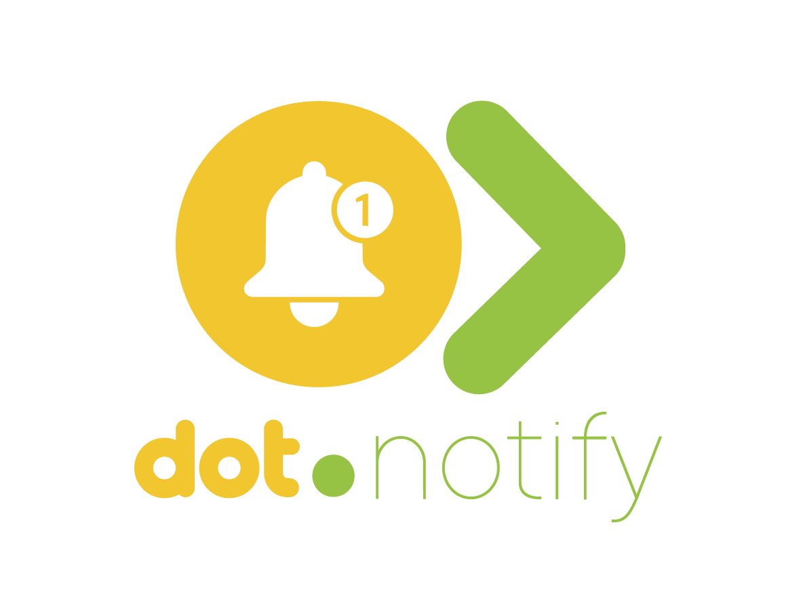

<div align="center">



<br /><br />

**Send, track, and optimise notifications across email, SMS, push, and Slack.**

<br />

   

<br /><br />

**Part of the [InfoDot Ecosystem](https://github.com/sakhileb/InfoDot)** &nbsp;·&nbsp; `notify.infodot.app`

</div>

---

## What is Dot.Notify?

Dot.Notify is the notification management platform in the InfoDot ecosystem. Teams configure delivery channels, build message templates with AI assistance, set event-triggered routing rules, and track every notification's journey from queue to delivery — with full analytics on open and click rates.

## Core Features

- Multi-channel delivery — email, SMS, push, webhook, Slack, and in-app
- Template builder with {{ variable }} interpolation
- AI template generation — describe the notification, get copy in seconds (falls back to a deterministic stub if no API key is configured)
- Rule engine model (`NotifyRule`) mapping trigger events to a channel + template — no management UI yet, see Roadmap
- Delivery log — full audit trail with status per recipient, searchable by recipient/subject and filterable by status
- User preference management — opt-in/out per notification type
- Bulk batch sends with delivery rate tracking
- Auto-generated webhook endpoint tokens (`NotifyWebhook`) — the receiving HTTP endpoint itself is not implemented yet, see Roadmap
- In-app self-notifications for this platform's own operators (channel degraded, batch failed)
- Ecosystem SSO from InfoDot hub

## Domain Models

- **NotifyChannel** — configured delivery channel (email, SMS, etc.)
- **NotifyTemplate** — message template with variable support
- **NotifyRule** — trigger-to-channel routing rule
- **NotifyLog** — delivery audit record per recipient
- **NotifyPreference** — per-user opt-in/out by notification type + channel
- **NotifyBatch** — bulk send with progress/delivery-rate tracking
- **NotifyWebhook** — inbound webhook endpoint registration (token generation only; no receiving route yet)

> A `notify_schedules` table exists in the schema for recurring/cron-based sends, but there is no `NotifySchedule` model or UI built on it yet.

## Roadmap / Known Gaps

- Inbound webhook receiving endpoint (route + signature verification) — not implemented; `NotifyWebhook` currently only issues tokens
- `NotifyRule` management UI (the model and relationships exist, no Livewire component yet)
- `NotifySchedule` model + recurring-send execution (table exists, unused)
- Knowledge Pack publishing to Dot.Brain (`observation`/`insight`/`outcome`/`incident`) — see `wiki.md` for the target shape

## Tech Stack

| Layer | Technology |
|---|---|
| Framework | Laravel 12 |
| Language | PHP 8.4 |
| Frontend | Livewire 3 · Alpine.js 3 · Tailwind CSS |
| Database | PostgreSQL 16 (shared across ecosystem) |
| Realtime | Laravel Reverb |
| Auth | Laravel Sanctum (InfoDot SSO) |
| AI | Anthropic Claude (`claude-sonnet-4-6`) |
| Storage | AWS S3 / Local (Flysystem) |
| Search | Laravel Scout · Meilisearch |
| Queue | Redis · Laravel Horizon |

## Quick Start

```bash
git clone https://github.com/sakhileb/Dot.Notify.git
cd Dot.Notify
cp .env.example .env
composer install
npm install && npm run build
php artisan key:generate
php artisan migrate
php artisan serve
```

> **Ecosystem SSO:** Set `DB_*` env vars to the shared InfoDot PostgreSQL instance and `APP_URL=https://notify.infodot.app`. Users authenticated through InfoDot gain access automatically via Sanctum handoff tokens.

## 🚢 Deployment

### Production Checklist

1. **Set environment**
   ```bash
   APP_ENV=production
   APP_DEBUG=false
   ```

2. **Install dependencies (no dev)**
   ```bash
   composer install --optimize-autoloader --no-dev
   npm ci
   ```

3. **Build frontend assets**
   ```bash
   npm run build
   ```

4. **Cache configuration**
   ```bash
   php artisan config:cache
   php artisan route:cache
   php artisan view:cache
   php artisan event:cache
   ```

5. **Run migrations**
   ```bash
   php artisan migrate --force
   ```

6. **Start the queue worker** (use `deploy/queue-worker.service` for systemd or `deploy/queue-worker.supervisord.conf` for Supervisor). Requires `QUEUE_CONNECTION=redis`, matching `.env.production.example`.
   ```bash
   php artisan queue:work redis --tries=3 --timeout=90
   ```

7. **Start the Reverb WebSocket server** (use `deploy/reverb.service` for systemd or `deploy/reverb.supervisord.conf` for Supervisor) -- never run this as a bare foreground command in production, it needs the same process supervision as the queue worker.
   ```bash
   php artisan reverb:start
   ```
   Binds to `REVERB_SERVER_HOST`/`REVERB_SERVER_PORT` (loopback-only by default in `.env.production.example`) -- it is not meant to be reachable directly from the internet. See "WebSocket Reverse Proxy" below for how browsers actually reach it over `wss://`.

### Web Server Configuration

#### Nginx

```nginx
server {
    listen 80;
    server_name your-domain.com;
    return 301 https://$host$request_uri;
}

server {
    listen 443 ssl;
    http2 on;
    server_name your-domain.com;
    root /var/www/notify/public;

    ssl_certificate     /etc/letsencrypt/live/your-domain.com/fullchain.pem;
    ssl_certificate_key /etc/letsencrypt/live/your-domain.com/privkey.pem;

    add_header X-Frame-Options "SAMEORIGIN";
    add_header X-Content-Type-Options "nosniff";

    index index.php;
    charset utf-8;

    location / {
        try_files $uri $uri/ /index.php?$query_string;
    }

    location = /favicon.ico { access_log off; log_not_found off; }
    location = /robots.txt  { access_log off; log_not_found off; }

    error_page 404 /index.php;

    location ~ \.php$ {
        fastcgi_pass unix:/var/run/php/php8.4-fpm.sock;
        fastcgi_param SCRIPT_FILENAME $realpath_root$fastcgi_script_name;
        include fastcgi_params;
    }

    location ~ /\.(?!well-known).* {
        deny all;
    }

    # Only Reverb's client-facing path (/app/{key}, what Echo/pusher-js
    # connects to) is proxied here. Its server-to-server publish API
    # (/apps/{id}/events etc.) is deliberately NOT exposed publicly --
    # config/broadcasting.php's reverb connection talks to it directly over
    # the internal REVERB_SERVER_HOST/PORT instead, so it never needs to be
    # reachable from outside this box.

    # WebSocket Reverse Proxy -- proxies wss://your-domain.com/app/... to the
    # internal reverb:start process (REVERB_SERVER_HOST/PORT, loopback-only
    # by default). The Upgrade/Connection headers are what turn this from a
    # plain HTTP proxy into a WebSocket one; without them the client's
    # protocol upgrade handshake fails and Echo falls back to polling or
    # errors outright. Long read_timeout because these are meant to be
    # long-lived connections, not request/response.
    location /app {
        proxy_pass http://127.0.0.1:8080;
        proxy_http_version 1.1;
        proxy_set_header Upgrade $http_upgrade;
        proxy_set_header Connection "upgrade";
        proxy_set_header Host $host;
        proxy_set_header X-Real-IP $remote_addr;
        proxy_set_header X-Forwarded-For $proxy_add_x_forwarded_for;
        proxy_set_header X-Forwarded-Proto $scheme;
        proxy_read_timeout 60s;
    }
}
```

#### Apache

Requires `mod_proxy`, `mod_proxy_wstunnel`, and `mod_ssl` enabled (`a2enmod proxy proxy_wstunnel ssl`).

```apache
<VirtualHost *:80>
    ServerName your-domain.com
    Redirect permanent / https://your-domain.com/
</VirtualHost>

<VirtualHost *:443>
    ServerName your-domain.com
    DocumentRoot /var/www/notify/public

    SSLEngine on
    SSLCertificateFile      /etc/letsencrypt/live/your-domain.com/fullchain.pem
    SSLCertificateKeyFile   /etc/letsencrypt/live/your-domain.com/privkey.pem

    <Directory /var/www/notify/public>
        AllowOverride All
        Require all granted
    </Directory>

    # WebSocket Reverse Proxy -- see the Nginx /app block above for what
    # this achieves and why. ProxyPass's own ws:// scheme (rather than
    # http://) is what makes mod_proxy_wstunnel handle the Upgrade
    # handshake instead of treating this as a normal HTTP proxy.
    ProxyPass        /app ws://127.0.0.1:8080/app
    ProxyPassReverse /app ws://127.0.0.1:8080/app
</VirtualHost>
```

### Real-Time Health Check

`GET /up/realtime` checks broadcasting config, queue connection, and whether `reverb:start` is actually accepting connections -- independently, so it reports which link broke rather than a single healthy/unhealthy bit. See `app/Http/Controllers/RealtimeHealthController.php`.

---

## Ecosystem

**Dot.Notify** is one of **21 platforms** in the InfoDot ecosystem, connected via shared PostgreSQL and Sanctum SSO. Visit [InfoDot](https://github.com/sakhileb/InfoDot) to explore the full platform map.

## License

MIT © [SK Digital / BluPin Incorporated](https://github.com/sakhileb)
